<div align="center">
  

  # Sony SmartWatch 2 (SW2) Modern Android Companion App
  
  **Dust off your Sony SmartWatch 2 and use it on Android 14+!**

  [](#)
  [](#)
  [](#-protocol-layout--reverse-engineering-findings)
  [](#-developer--protocol-lab-python--windows-11)

</div>

---

## 💡 Why This Project Exists

The **Sony SmartWatch 2 (SW2)** remains an outstanding piece of wearable hardware: a premium aluminium body, water resistance, multi-day battery life, and a transflective display that becomes *more* readable under direct sunlight.

Unfortunately, Sony abandoned the software ecosystem years ago:
- The official **Sony Smart Connect** and **LiveWare Manager** apps crash on modern Android releases.
- Legacy background services and 32-bit binaries fail to run on Android 10, 11, 12, 13, and 14+.
- Modern OS battery optimization, `NotificationListenerService` restrictions, and Bluetooth permission overhauls completely broke the original pairing and notification flow.

**This project revives the Sony SmartWatch 2 for the modern era.** It provides a clean, native, standalone Android Companion App built on top of a fully reverse-engineered Bluetooth RFCOMM/SPP Costanza protocol stack — allowing you to take your SW2 out of the drawer and wear it every day with your current smartphone.

---

## ✨ Features & Architecture

- 🚀 **Zero Sony Dependencies**: Operates completely standalone — no obsolete Sony Smart Connect, LiveWare Manager, or deprecated Play Store plugins needed.
- 🔔 **Instant Pop-up Notifications**: Real-time pop-up notification banners with vibration alerts for incoming messages, emails, chats, and calls.
- 📜 **On-Watch Notification Drawer & History**: Full bidirectional synchronization with the watch's internal notification storage (`ResourceNotification`). Browse past notifications directly from the watch UI with proper subscreen rendering.
- 📱 **Built for Android 14+**: Implements modern Android architecture including Foreground Services, correct `BLUETOOTH_CONNECT` / `BLUETOOTH_SCAN` runtime permissions, battery optimization exemptions, and modern `NotificationListenerService`.
- 🕒 **Automatic Clock & Locale Sync**: Synchronizes the watch's internal RTC, 12/24-hour display format, date format, and language strings on connection.
- 📳 **Haptic Feedback**: Programmable vibration patterns for alerts and incoming events.
- 🔬 **Built-in Windows 11 / Python Protocol Lab**: A standalone Python controller (`sw2_controller.py`) for rapid reverse engineering, protocol verification, packet inspection, and packet replay from your PC.

---

## 📲 Getting Started (Android Companion App)

### 1. Prepare your SmartWatch 2
1. If previously paired, perform a factory reset: hold down the power button until the watch restarts and displays the pairing prompt ("Waiting for phone / Smart Connect").
2. Ensure Bluetooth is enabled on the watch.

### 2. Pair with your Smartphone
1. Open your Android phone's **Settings -> Connected devices -> Pair new device**.
2. Select **SmartWatch 2** from the list.
3. Confirm the pairing code on both the phone and watch (PIN is `0000` or confirmed automatically).

### 3. Install & Configure the Companion App
1. Install the Companion APK on your phone.
2. Launch the app and grant the required modern Android permissions:
   - **Notification Access**: Enables the app to forward notifications to your watch.
   - **Nearby Devices / Bluetooth**: Required on Android 12+ for RFCOMM socket communication.
   - **Battery Optimization Exemption**: Ensures reliable background connectivity without the OS terminating the service.
3. The Companion App will automatically connect to the watch's RFCOMM SDP service (`8E780522-3C51-11E1-8D8D-001CC4D601D8`), complete the Sony handshake, and start synchronizing notifications.

---

## 🧪 Developer & Protocol Lab (Python / Windows 11)

For developers and protocol hackers, this repository includes a complete Python-based reverse engineering suite (`sw2_controller.py`). It connects directly from a Windows 11 notebook to the watch via Bluetooth — **no Android build environment required**.

### Running the Python Controller

Windows 11 supports three connection options:

#### Option 1: Native Windows 11 RFCOMM Server (Zero-Config, Recommended) ⭐
The watch acts as a Bluetooth client and actively seeks the Sony Costanza SDP service (`8E780522-3C51-11E1-8D8D-001CC4D601D8`). The controller advertises this service natively using Windows 11 WinRT APIs:
```cmd
python sw2_controller.py
```
*No manual COM port or MAC address needed. As soon as the watch is in range, it connects automatically in 1–2 seconds.*

#### Option 2: Virtual Bluetooth COM Port (Classic)
Connect via an incoming/outgoing serial COM port configured in Windows Bluetooth settings:
```cmd
python sw2_controller.py --com COM3
```

#### Option 3: RFCOMM Client Socket (Direct MAC Address)
Connect directly to the watch's MAC address:
```cmd
python sw2_controller.py --mac B4:52:7D:F3:E8:81 --channel 1
```

### Interactive Console Menu

Once connected, `sw2_controller.py` executes the full Sony handshake sequence and presents an interactive test shell:

```text
======================================================
  Sony SmartWatch 2 Reverse Engineering Controller
======================================================
  [1] Synchronize time
  [2] Test vibration pattern
  [3] Send test notification (title & body)
  [4] Re-register Notification Extension
  [5] Query status (FOTA & version)
  [q] Quit
------------------------------------------------------
```

All incoming watch packets (ACKs, NACKs, touch events, swipe gestures, hardware buttons, and sensor reports) are **received, decoded, and logged in real-time as plaintext and hex dumps via a dedicated background thread**.

---

## 🔬 Protocol Layout & Reverse Engineering Findings

### 1. Notification Binary Layout (Step 24 / 322 Bytes)

Notifications (`ResourceNotification`) follow the exact **322-byte memory layout** reconstructed from `libprotocol.so`:

```text
Offset       Length   Description
-----------------------------------------------------------------------------------
0x00..0x03    4 B     Total packet length (Little-Endian: 322 or 0x0142)
0x04..0x07    4 B     Packet type (TYPE_RESOURCE = 1)
0x08..0x0B    4 B     Message sequence ID
0x0C..0x0F    4 B     Resource CID (e.g. 0x00100064)
0x10..0x13    4 B     Padding (Zeroes)
0x14..0x15    2 B     hasCid = 1
0x16..0x17    2 B     Padding
0x18..0x1B    4 B     dataLength (totalSize - 20 = 302 or 0x012E)
0x1C..0x1D    2 B     subType = 2 (Notification)
0x1E..0x1F    2 B     Padding
0x20..0x23    4 B     localization = 0
0x24..0x27    4 B     notificationExtensionCid (CID_NOTIFICATION_EXTENSION)
0x28..0x2F    8 B     timeStamp (Unix timestamp in milliseconds)
0x30          1 B     personal = 0
0x31          1 B     readStatus = 0
0x32..0x33    2 B     fieldCount (e.g. 7 or 8)
0x34..0x69   54 B     mOnlineMenu (menuCid = -1, count = 0, 48B zeroes)
0x6A..0x9F   54 B     mOfflineMenu (menuCid = -1, count = 0, 48B zeroes)
0xA0..0x12F 144 B     mFields table (18 slots à 8 bytes: short key, short pad, int value)
0x130..0x131  2 B     subScreenCount (1 if screenCid present, otherwise 0)
0x132..0x141 16 B     mSubScreens (left=0, top=0, right=219, bottom=175, opaque=2, pad=0, screenCid)
-----------------------------------------------------------------------------------
Total Size:           322 Bytes (when subScreenCount = 1)
```

### 2. ResourceExtension Layout (60 Bytes)

For the firmware to display notifications under an application drawer, an extension must be registered using this precise 60-byte payload:

```text
Offset       Length   Description
-----------------------------------------------------------------------------------
0x00..0x03    4 B     Total packet length (60 or 0x003C)
0x04..0x07    4 B     Packet type (TYPE_RESOURCE = 1)
0x08..0x0B    4 B     Message sequence ID
0x0C..0x0F    4 B     Extension CID (e.g. 0x00100002)
0x10..0x13    4 B     Padding (Zeroes)
0x14..0x15    2 B     hasCid = 1
0x16..0x17    2 B     Padding
0x18..0x1B    4 B     dataLength (totalSize - 32 = 28 or 0x001C)
0x1C..0x1D    2 B     subType = 4 (ResourceExtension on the wire)
0x1E..0x1F    2 B     Padding
0x20..0x23    4 B     nameCid (String Resource CID)
0x24..0x27    4 B     iconCid (48x48 Image CID)
0x28..0x2B    4 B     iconOfflineCid (48x48 Image CID)
0x2C..0x2F    4 B     color (e.g. 0xFF000000 or -16777216)
0x30..0x31    2 B     priority (4 = APPLICATION_ALERT_PRIORITY_NOTIFICATION_MSG)
0x32          1 B     capabilities = 1 (Bit 0: Notification API enabled)
0x33          1 B     supportedDrawingSpecs = 0
0x34..0x37    4 B     showOnHomeScreen (1 = True, 0 = False)
0x38..0x3B    4 B     relativeCid = -1
-----------------------------------------------------------------------------------
Total Size:           60 Bytes
```

### 3. Image & Icon Compression (Raw DEFLATE)

> [!IMPORTANT]
> The SmartWatch 2 firmware requires compressed images (`subType = 5`, `compressionType = 4`) formatted in **pure Raw-DEFLATE** (RFC 1951) **without** zlib wrappers or Adler32 footers (`wbits=-15`).
> Standard Python `zlib.compress()` prepends the RFC 1950 header (`0x78 0x9C`), which causes the watch to reject the frame with a **NACK**. Always compress using:
> ```python
> compressor = zlib.compressobj(wbits=-15)
> deflated = compressor.compress(raw_rgb565) + compressor.flush()
> ```

### 4. Large Packets & Fragmentation

Packets exceeding 512 bytes (such as full-screen bitmaps or large font packages) are automatically partitioned by the codec into **Type 11 (TYPE_FRAGMENT)** frames with a maximum payload of 492 bytes each.

---

## 📂 Repository Contents

| Path | Purpose |
|---|---|
| `sw2_controller.py` | Complete Python SW2 controller (RFCOMM server, COM, WinRT, packet decoder, menu) |
| `test_notification.py` | Standalone script for sending test notification packets |
| `test_icon.py` | Icon generator (RGB565 raw DEFLATE) for app extensions |
| `telegram_helper.py` | Remote helper to forward logs and test alerts to Telegram |
| `splash_image.svg` | Vector illustration and banner for the project |
| `TELEGRAM_BOT.md` | Documentation for Telegram Bot remote control and log capture |
| `requirements.txt` | Python dependencies (optional; pure-Python fallbacks included) |
| `reference/` | Disassembled Sony companion APK sources, decompiled Java/Kotlin & `libprotocol.so` |

---

## 🤖 Remote Logging & Bot Helper

For automated testing and remote log capturing directly to your smartphone:
- See [TELEGRAM_BOT.md](TELEGRAM_BOT.md)
- Send a test message:
  ```cmd
  python telegram_helper.py --text "SW2 notification test successful!"
  ```

---

## 📜 License

Reverse-engineered and developed for the open-source community to preserve and modernize functional hardware. Provided under the MIT License.
